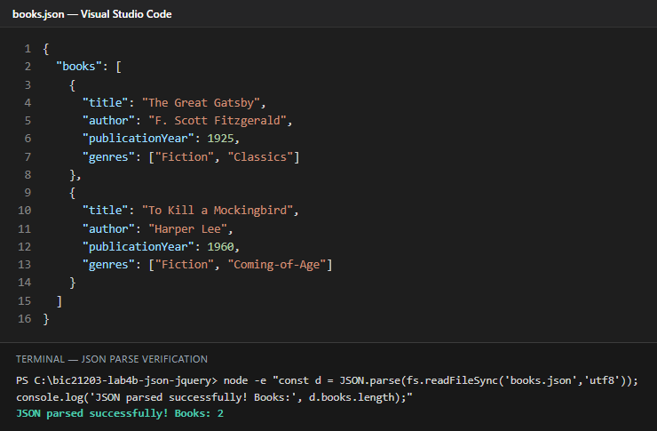
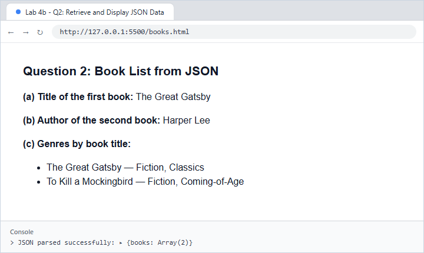
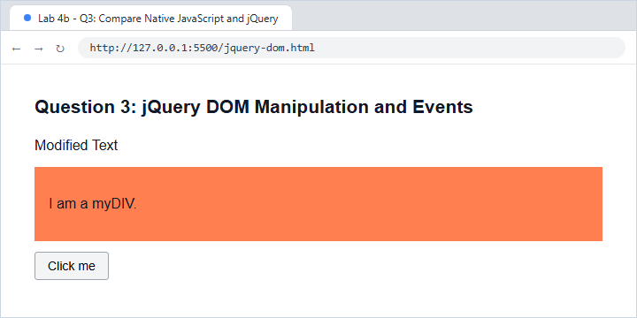
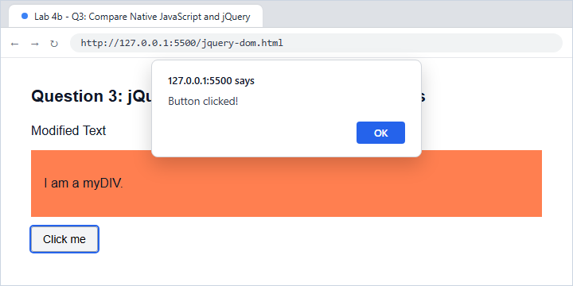

# BIC21203 Lab 4b: Client-Side Scripting (JSON and jQuery)

- **Name:** Muhammad Imran Hakim Bin Zulkifli
- **Matric No:** CI250136
- **Course:** BIC21203 Web Development (Section 2)

## Overview
This repository contains my files for Lab 4b covering JSON, `fetch()`, and jQuery 4.0.0:
- **Question 1 (`books.json`):** Valid JSON dataset containing a `"books"` array with two book objects (*The Great Gatsby* and *To Kill a Mockingbird*).
- **Question 2 (`books.html`):** Fetches `books.json` using `fetch()` and `async/await`, displays the first book's title, second book's author, and genres grouped by book title using `textContent` and `createElement()`, and shows a friendly error message if loading fails.
- **Question 3 (`jquery-dom.html`):** Uses jQuery 4.0.0 (`https://code.jquery.com/jquery-4.0.0.min.js`) to update text with `.text()`, add a CSS class with `.addClass()`, and handle button clicks with `.on("click", ...)`.

## Setup Instructions
1. Clone or download this repository and open the folder in **Visual Studio Code**.
2. Because `fetch()` requires HTTP/HTTPS and does not work over `file://`, start a local server:
   - **Option A (VS Code Live Server):** Right-click `books.html` and click **Open with Live Server** (`http://127.0.0.1:5500/books.html`).
   - **Option B (Python HTTP Server):** Run `python -m http.server 5500` in the terminal and open `http://127.0.0.1:5500/books.html` and `http://127.0.0.1:5500/jquery-dom.html`.

## Screenshots

### Question 1: `books.json`

### Question 2: Retrieve and Display JSON Data

### Question 3: jQuery DOM Manipulation & Alert
DOM manipulation:

Button click alert:

